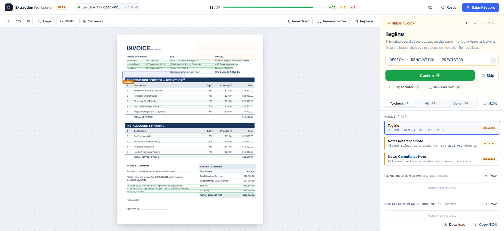

# Extraction Workbench

A review tool for AI-extracted document data. Upload an invoice or form, check every extracted value against the page, and submit the verified record to the application that opened the workbench.

The review UI is `index.html` plus plain ES modules in [`static/`](static/), with no build step. A small Flask API in [`api/`](api/) serves the page, supplies the reference schema, and runs the AI extraction.

## Screenshot



*`invoice_INV-2026-982.pdf` right after extraction. This screenshot predates the stricter auto-confirmation described under [Status model](#status-model): fields found away from their label, and rows whose numbers don't all match the page, now wait for a reviewer.*

## Running it

```sh
cd api
python -m venv .venv
.venv/Scripts/activate        # Windows; use .venv/bin/activate elsewhere
pip install -r requirements.txt
cp .env.example .env          # set OLLAMA_MODEL, OLLAMA_API_KEY and FORM_URL
python app.py
```

Then open <http://127.0.0.1:5000/>. To try it, drop in [`invoice_INV-2026-982.pdf`](invoice_INV-2026-982.pdf).

`python app.py` runs Flask's development server. In production, run a WSGI server instead, for example `waitress-serve --host 127.0.0.1 --port 5000 --threads 8 --channel-timeout 180 app:app` from `api/`, behind a TLS proxy.

See [`api/README.md`](api/README.md) for the API's endpoints and settings.

## What it does

1. **Upload** an image (JPG/PNG) or PDF (first page only) of a document.
2. The page runs **OCR** locally in the browser (Tesseract.js) to read text and locate it on the page.
3. At the same time, the file is sent once to the **extraction API** (`POST /extract`). The API converts it to text with MarkItDown, then asks an Ollama model to map that text onto the reference schema (for example invoice number, vendor address, line items). An image has no text layer, so for images the page sends its OCR text along and the API maps that instead.
4. Each extracted field is shown as a **marker box** on the document image, color-coded by status. Next to it, a **review rail** lets you confirm, edit, flag or skip each value.
5. When every field is checked (or you submit early), the JSON record is **posted back to the parent window** (`window.opener`) that launched the workbench.

## Key features

- **Document viewer**: zoom in and out, fit to page or width, and a close-up mode that keeps the focused field centered and readable.
- **Draggable, resizable markers**, with a mouse, finger or pen: if a box is in the wrong place, drag it over the correct text and click "Re-read box" to run OCR on just that region. "Re-read boxes" in the toolbar does this for every unconfirmed box.
- **Status model** for every field and row (see below), with a review rail in three views (*To check*, *All*, *Done*), a progress bar and running counts in the top bar.
- **Repeatable line-item groups** (for example `construction_services` and `installations_and_finishing`) for any schema field that declares a `nested` sub-schema. You can add rows by hand when none were detected.
- **One-click suggestions**: when the OCR reading of a field's box differs from the extracted value, the OCR text is offered as a one-click replacement.
- **Keyboard-driven review**: press `?` to see the shortcuts. Letter shortcuts work with Shift or Caps Lock on.

  | Key | Action |
  |---|---|
  | `Enter` | Confirm the focused item and move to the next |
  | `↑` / `↓` (or `k` / `j`) | Move through the queue |
  | `/` | Focus the value input |
  | `F` | Flag the item for later |
  | `S` | Skip the item |
  | `R` | Re-read the item's box |

- **JSON preview**: the "JSON" tab shows a live snapshot of the record, including each item's status and `verified_by`: `reviewer` (you confirmed it), `auto` (the page backs it up), or `edited` (you changed the value but didn't confirm it). The rail footer has "Download" and "Copy JSON".
- **Reset**: "Revert edits" puts every value and box back to the last extraction. "Clear document" starts over. "Re-extract" asks first if you've already confirmed, edited or moved anything.

### Status model

- **Confirmed**: you confirmed it, or the page itself backs it up:
  - a **field** is confirmed automatically when its value reads on the page, with high OCR confidence, on a line that also carries a word of its label (`Tax` for `tax_amount`, `Subtotal` for `subtotal`). A value found elsewhere on the page, such as the BILL TO company extracted as the vendor, waits for you.
  - a **line-item row** is confirmed automatically only when every filled cell (description, quantity, price, total) reads on the same line of the page.
- **Needs a look**: extracted but low-confidence, not located on the page, found away from its label, or flagged.
- **Not found**: nothing was extracted.

Values are matched as whole words, ignoring case, spacing and thousands separators, so `CO` matches "Denver, CO" but not "Construction".

## Configuration

Where the page talks to the API is set in [`static/js/config.js`](static/js/config.js):

```js
export const SCHEMA_URL = '/schema';
export const CONFIG_URL = '/config';
export const AI_URL = '/extract';
```

They're relative because the Flask API serves the page. If you host the page somewhere else, change them to the API's full URLs and add the page's origin to `CORS_ORIGINS` in `api/.env`. The page's own query string is forwarded on every API call.

Where submitted records go is set by two values:

- **`FORM_URL`**: the exact origin of the application that opens the workbench, used as the `postMessage` target origin. If it's missing or isn't a URL, the record is copied to the clipboard instead and the workbench says why.
- **`FORM_TYPE`**: sent as the message's `type`, so the parent can tell which form the record is for.

When the Flask API serves the page, both come from `api/.env` through `GET /config`. When pms_api renders `index.html` as a Django template, the `{{form_url|escapejs}}` and `{{form_type|escapejs}}` placeholders in its `#pageConfig` block take precedence.

Whatever serves `index.html` must also serve the `static/` folder next to it: the page loads `static/css/workbench.css` and `static/js/main.js` relative to its own URL. The Flask API does this. If pms_api renders the page, serve `static/` at the matching path and route `/schema`, `/config` and `/extract` to this API (or change the URLs in `config.js`).

### Defining the schema

The extraction target schema is in [`api/reference_schema.json`](api/reference_schema.json). The page loads it from `GET /schema`, and `POST /extract` maps documents onto the same file, so the two always agree. To use a different file, set `REFERENCE_SCHEMA_FILE` in `api/.env`.

```json
{
  "invoice_no": "",
  "invoice_date": "",
  ...
  "construction_services": { "nested": {
    "description": "", "sq_ft": "", "price_per_sq_ft": "", "total": ""
  }}
}
```

- Top-level scalar keys become individual review fields.
- A key whose value is an object with a non-empty `nested` sub-object becomes a **repeatable group**. It's shown as multiple rows, with a "+ Row" button in the queue.
- Field labels come from title-casing the snake_case key (for example `vendor_company_name` becomes "Vendor Company Name"). The same words are what auto-confirmation looks for next to a value, so keys that match the document's labels confirm more often.

The schema should mirror the backend serializer or model the extracted data is saved to.

## Integration

This page is designed to be opened as a **popup or child window** from another application:

- On submit, it calls `window.opener.postMessage({ type: FORM_TYPE, data }, FORM_URL)` with the final record. The record is shaped as `{ field_key: value, ..., group_key: [ {cell_key: value, ...}, ... ] }`.
- If there's no `window.opener`, or `FORM_URL` isn't set, the record is copied to the clipboard instead and a notice is shown.
- The parent application should listen for the `message` event and check `event.origin` before trusting the payload.
- To keep the API private to that application, set `WORKBENCH_LAUNCH_SECRET` and open the workbench with a signed token, `/?token=<token>`. See [`api/README.md`](api/README.md#access-control).

## Project layout

```
index.html                 markup, plus the #pageConfig block pms_api can render
static/css/workbench.css   styles
static/js/main.js          entry point: works out where records go, starts the workbench
static/js/workbench.js     state, rendering and events
static/js/review-model.js  status rules, locating values on the page, exported records (no DOM)
static/js/schema.js        reading the reference schema
static/js/api.js           calls to the extraction API
static/js/documents.js     PDF/image to canvas (pdf.js, loaded on first use)
static/js/ocr.js           one Tesseract.js worker for the page
static/js/ui.js, util.js, icons.js, config.js
api/                       the Flask API, its settings and tests
tests/unit/                Node tests for the browser modules
tests/e2e/                 browser tests (Playwright) against the real API with a stubbed model
```

## Tests

```sh
pip install -r api/requirements-dev.txt
python -m playwright install chromium   # or set PLAYWRIGHT_CHANNEL=chrome / msedge to use an installed browser
pytest                                  # API tests and end-to-end browser tests
npm test                                # unit tests for static/js (Node 22+, nothing to install)
```

The end-to-end tests load pdf.js and Tesseract.js from their CDNs, so they need network access. The same checks run in GitHub Actions on every push.

## Dependencies

Browser (loaded from CDNs):

- [pdf.js](https://cdnjs.cloudflare.com/ajax/libs/pdf.js/) 4.10.38: renders the first page of an uploaded PDF to a canvas. It loads the first time a PDF is opened, with font evaluation turned off.
- [Tesseract.js](https://cdn.jsdelivr.net/npm/tesseract.js/) 5.1.1: in-browser OCR, used for the initial text and line detection and for "Re-read box". Its script is pinned with a Subresource Integrity hash.
- Google Fonts: Plus Jakarta Sans (UI) and IBM Plex Mono (data and values).

API: Flask, MarkItDown, langchain-ollama, Flask-Limiter and Waitress. [`api/requirements.in`](api/requirements.in) lists them, and [`api/requirements.txt`](api/requirements.txt) pins the full tree.

## Fallbacks and limits

- **Extraction API down or failing:** the page matches `label: value` lines in the in-browser OCR text instead, and says why extraction failed. Values found this way always wait for a reviewer. Line items aren't filled in this way; you add them by hand.
- **Tesseract.js fails to load:** values can't be located on the page, so their boxes start in default positions and wait for review.
- **pdf.js fails to load:** PDFs can't be opened, but images still work.
- **Schema can't be loaded:** the page shows a warning and tries again with the next document. Opening `index.html` as a local file doesn't work; open it through the API.

## Browser support

Requires a current browser with ES modules, Pointer Events, Canvas and the Clipboard API. pdf.js 4 sets the floor for PDFs at roughly Chrome or Edge 119+, Firefox 121+ and Safari 17.4+. The end-to-end tests run in Chromium.
